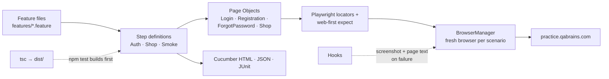

<div align="center">

# 🎭 QA Brains Automation — TypeScript + Playwright

### Cucumber BDD suite for the QA Brains practice site — login, registration, password reset, e-commerce cart, navigation

[](https://git.io/typing-svg)

<!-- ============ STATUS BAR ============ -->
[](https://github.com/rbchy/QaBrainsAutomationTypeScriptPlaywright/actions/workflows/tests.yml)
-22c55e?style=for-the-badge&logo=checkmarx&logoColor=white)


</div>

---

## 📌 At a Glance

<table>
<tr>
<td width="50%" valign="top">

**🙋 What this is**

The **TypeScript** edition of the QA Brains practice-site suite. It runs the same Gherkin scenarios as the [Java + Playwright](https://github.com/rbchy/QaBrainsAutomationJavaPlaywright), [Selenium](https://github.com/rbchy/QaBrainsAutomationJavaSelenium) and [Cypress](https://github.com/rbchy/QaBrainsAutomationCypressJavaScript) editions, using **cucumber-js** with the Playwright library and its web-first `expect` assertions.

The suite covers authentication, the **e-commerce demo** (shop login, adding to and removing from the cart, product details, product cards) and the sidebar demo modules. Every push runs it in **GitHub Actions** with headless Chromium.

> *A check that cannot fail is not a check. Every assertion here can fail.*

</td>
<td width="50%" valign="top">

**📍 Quick facts**

| | |
|---|---|
| 🧪 **Scenarios** | 15 in 7 feature files |
| ✅ **CI** | 15 / 15 · headless Chromium · ≈ 63 s |
| 🧱 **Pattern** | Page Objects + web-first `expect` |
| 🌐 **Browsers** | Chromium (default) · Firefox · WebKit via `BROWSER=` |
| 📊 **Reports** | Cucumber HTML · JSON · JUnit XML |
| 📸 **On failure** | Screenshot attached + page text in the log |

</td>
</tr>
</table>

---

## ✅ Latest Results

| Feature file | Scenarios | What is asserted | Result |
|---|---:|---|---|
| 🔐 `Login.feature` | 2 | Valid login → `?logged=true` + success banner · invalid → *"Your email and password both are invalid!"*, no banner |  |
| 🚪 `Logout.feature` | 1 | `logged=true` gone, Login button back, no banner |  |
| 📝 `Registration.feature` | 2 | Unique e-mail → *successfully* · e-mail without `@` blocked by the browser (`validity.valid === false`) |  |
| 🔑 `ForgotPassword.feature` | 2 | Valid e-mail → `?forgot=true` + *"Password is reset successfully"* · malformed → browser says *"missing an '@'"* |  |
| 🛒 `CartCheckout.feature` | 2 | Starts from an empty cart · add → exactly 1 in the cart, still 1 after reload · remove → 0, still 0 after reload |  |
| 🔄 `RegressionTests.feature` | 3 | Add 3 → exactly 3 · product details show name and price · every card has name, price and one *Add to cart* button |  |
| 💨 `SmokeTests.feature` | 3 | Home page login form · Registration, Forgot Password, Form Submission, Drag and Drop and E-Commerce open from the sidebar |  |
| **Total** | **15** | | **100 % · 1 m 03 s** |

<sub>GitHub Actions, Ubuntu 24.04, Node 20, headless Chromium ([workflow](.github/workflows/tests.yml)). The earlier local report ([Cucumber report.pdf](Cucumber%20report.pdf)) showed 14 passed and 1 pending, but several of those checks could not fail. See the maintenance log.</sub>

---

## 🏗️ Framework Architecture



- **Web-first assertions:** `expect(locator).toBeVisible()` / `toHaveCount()` / `toHaveURL()` retry until they pass or time out. The framework has no fixed sleeps.
- **Exact cart counts:** each add or remove waits until the number of *Remove from cart* buttons changes by exactly one. The cart is emptied first, so an earlier run cannot leak in.
- **Fresh browser per scenario:** a new browser, context and page with `baseURL` set, so steps use short paths like `goto("/registration")`.
- **Built from source:** `npm test` compiles the TypeScript first, so Cucumber never runs stale JavaScript.
- **Config, not code:** the URL, the public practice accounts and the timeouts live in `config/config.ts`. `HEADLESS` and `BROWSER` come from the environment.

---

## 🛠️ Tech Stack

| Layer | Technology | Version |
|---|---|---|
| Language | TypeScript | 5.9 |
| Browser automation | Playwright (`@playwright/test` expect) | 1.60 |
| BDD | `@cucumber/cucumber` | 11.3 |
| Runtime | Node.js | 20 |
| Reporting | Cucumber HTML / JSON / JUnit | — |
| CI | GitHub Actions | — |

---

## 📁 Project Structure

```
QaBrainsAutomationTypeScriptPlaywright/
├── .github/workflows/tests.yml     ← headless run on every push
├── config/config.ts                ← URL, practice accounts, timeouts, HEADLESS / BROWSER
├── features/                       ← 7 feature files, 15 scenarios
├── src/
│   ├── hooks/Hooks.ts              ← browser per scenario, screenshot + page text on failure
│   ├── pages/                      ← LoginPage, RegistrationPage, ForgotPasswordPage, ShopPage
│   ├── steps/                      ← AuthSteps, ShopSteps, SmokeSteps
│   └── utils/BrowserManager.ts
├── cucumber.js                     ← formats and step paths
├── tsconfig.json
└── package.json
```

---

## ⚙️ Getting Started

**Prerequisites:** Node.js 18+

```bash
git clone https://github.com/rbchy/QaBrainsAutomationTypeScriptPlaywright.git
cd QaBrainsAutomationTypeScriptPlaywright
npm ci
npx playwright install chromium

npm test                          # build + all scenarios (headed)
HEADLESS=true npm test            # what CI runs
npm run test:smoke                # @smoke only
npm run test:cart                 # @Cart only
BROWSER=firefox npm test          # another engine
```

| Report | Location |
|---|---|
| Cucumber HTML | `reports/cucumber-report.html` |
| Cucumber JSON / JUnit XML | `reports/cucumber-report.json` · `reports/cucumber-report.xml` |

---

## 🧹 Maintenance Log

| Change | Why |
|---|---|
| `npm test` builds the TypeScript first; `dist/` removed from git | Cucumber ran the **committed** `dist/` JavaScript, so edits to `src/` never ran until someone remembered to compile |
| Smoke steps assert the real sidebar modules | They looked for Catalog, Blog, Wish List and Refer a Friend, which this site does not have. They logged *"Could not find nav link"* and still passed |
| Regression steps drive the real cart and product pages | They set `expected = 2; actual = 2` and compared them, or asserted `assert.ok(true)` |
| R-01 runs again | It was marked `@known_issue` and skipped as *pending* ("E-Commerce component fails to load"), but the e-commerce demo works |
| Login / logout check the success banner and `logged=true` | Login passed if any element matched `[class*='account']` or the URL lacked "login", which is always true on the home page. Logout passed if any password field existed |
| Registration and Forgot Password compare real messages | Success passed on words like "success" or "confirm" anywhere on the page. The error steps ignored the expected text |
| Cart checks count exactly | Add and remove used fixed 1.5 s waits and only logged a warning when the button did not change |
| GitHub Actions | Every push is checked |
| README describes only what exists | It listed `dist/` as part of the source and a `QaBrainAutomation-TypeScript-Playwright` folder name |

---

## 📈 Roadmap

- [x] Every assertion can fail; GitHub Actions
- [ ] Chromium, Firefox and WebKit as a CI matrix
- [ ] Form Submission and Drag and Drop scenarios
- [ ] Parallel scenarios (`--parallel`) with one browser per worker
- [ ] Publish the HTML report to GitHub Pages

---

## 🔗 Related Projects

| Project | Stack |
|---|---|
| 🎭 [QA Brains — Java + Playwright](https://github.com/rbchy/QaBrainsAutomationJavaPlaywright) | Same scenarios in Java, CI green |
| 🧪 [QA Brains — Java + Selenium](https://github.com/rbchy/QaBrainsAutomationJavaSelenium) | Same scenarios on Selenium 4, CI green |
| 🌲 [QA Brains — Cypress](https://github.com/rbchy/QaBrainsAutomationCypressJavaScript) | Same scenarios on Cypress 13, CI green |
| ⭐ [RbcTcsWorld E-Commerce Suite](https://github.com/rbchy/RbcTcsWorld_ECommerceSuite) | Spring Boot · Playwright (TypeScript) · Selenium · CI quality gates |

<sub>All projects: [github.com/rbchy](https://github.com/rbchy)</sub>

---

## 👤 Author

<div align="center">

**Ranajit Baran Chowdhury (RB Chowdhury)**
QA Automation Engineer / SDET · West Norriton, Pennsylvania, USA

[](https://www.linkedin.com/in/rbchy/)
[](https://github.com/rbchy)
[](https://rbchy.github.io/rbchy/)
[](https://rbc6543.wixsite.com/rbc-portfolio)
[](mailto:chyranajit@gmail.com)

<sub>QA Brains is a public practice site. Only its published practice accounts are used.</sub>

⭐ *If this project helps you, a star on the repo is appreciated.*

</div>
